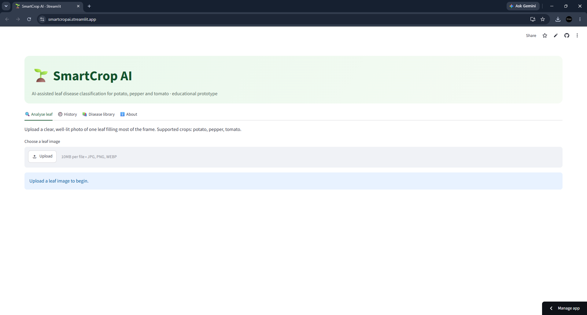
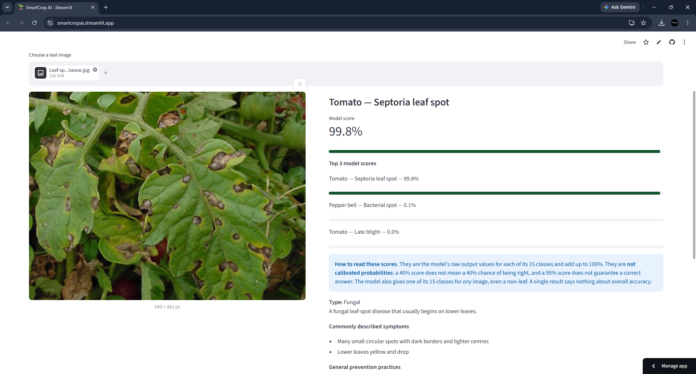
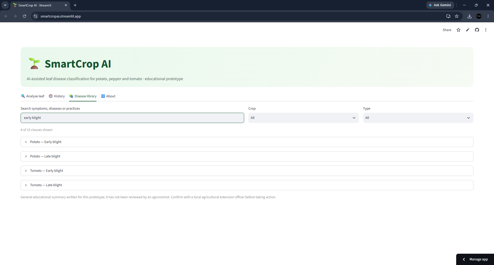
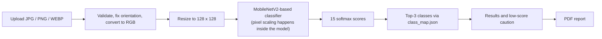

# SmartCrop AI

> AI-powered plant disease detection from leaf images.

[](https://smartcropai.streamlit.app/)
[](https://github.com/Sumayya012)


---

## Live Demo

Try the deployed application directly in your browser:

**[https://smartcropai.streamlit.app/](https://smartcropai.streamlit.app/)**

No local installation is required to try the live application.

Source code: [github.com/Sumayya012/SmartCrop-AI](https://github.com/Sumayya012/SmartCrop-AI)

---


## Application Preview

### Home Page


### Top-3 Disease Predictions


### Disease Information Library


[**Try SmartCrop AI Live →**](https://smartcropai.streamlit.app/)


---

## Overview

Plant diseases are often noticed late, and recognising them by eye takes experience. **SmartCrop AI** is an independent machine-learning project that classifies a leaf photograph into one of 15 potato, pepper and tomato conditions (diseased or healthy) and presents the result in a simple web interface.

It is an educational prototype for students, developers and anyone exploring image-based plant disease detection. It is **not** a replacement for expert agricultural diagnosis (see [Limitations and Responsible Use](#limitations-and-responsible-use)).

---

## Key Features

- **Image upload and disease prediction** for JPG, PNG and WEBP images up to 10 MB, with warnings for very small, very dark or overexposed images.
- **Top-3 predictions** with a model score for each class, and a caution when the top score is below 60%.
- **Disease information library and search.**
- **Downloadable PDF report** containing the image, top-3 results, class information, suggested next steps and a disclaimer.
- **Prediction history**, kept in memory for the current browser session by default.

<!-- VERIFY: prediction history is inferred from the history settings in smartcrop/config.py; confirm it appears in the app UI, otherwise delete that bullet. -->

---

## Application Outputs

For each uploaded image the app lists the model's three most likely classes, each with a **model score**, and the prediction can be exported as a PDF report.

The model score is the model's own output for that class. It is **not** a calibrated probability and does not mean the diagnosis is correct. Photos that differ from the training data (a different crop, lighting, background or leaf condition) can still produce a high score for the wrong class. The 60% threshold used for the low-score caution is a simple heuristic. Treat every result as an indication to investigate further, not a verdict.

<!--
Add genuine output screenshots here once captured (do not use mock-ups):

<p align="center">
  
</p>
<p align="center">
  
</p>
-->

---

## How It Works



1. **Validation.** Uploads must be non-empty, at most 10 MB and at most 40 million pixels, and must decode as JPEG, PNG or WEBP. Orientation is corrected from EXIF data and the image is converted to RGB. Quality warnings are raised for images with a side under 64 px, or that are very dark or overexposed.
2. **Preprocessing.** The image is resized to **128 × 128** (nearest-neighbour by default, matching the training data generators) and passed to the model as raw 0 to 255 values. The model scales pixels to [-1, 1] itself, so no extra scaling is applied.
3. **Inference.** The model returns 15 softmax scores. Output shape and a valid probability distribution are checked before use.
4. **Class mapping.** Scores are mapped to class names using `class_map.json`, a label-to-index JSON file that is validated on load (integer, unique, contiguous indices and the expected 15 classes). Names are converted to readable form for display.
5. **Results.** The top three classes are returned with their scores. If the top score is below 0.60 the result is flagged as low confidence.
6. **Report.** A PDF is generated with ReportLab.

---

## Model and Dataset

**Architecture.** A Keras Sequential model with a 128 × 128 × 3 input:

`Rescaling` → `MobileNetV2` (without its top classifier) → `GlobalAveragePooling2D` → `Dropout(0.3)` → `Dense(15, softmax)`

**Loading.** On startup the app rebuilds this architecture in code and loads the weights from `models/model.keras`, then runs a smoke test (a forward pass whose output must be a valid probability vector), so a faulty model fails at startup rather than at prediction time. The original saved file contains a Lambda layer that stores Python bytecode; deserialising it executes that code, so this fallback is disabled unless explicitly enabled for files you created yourself.

**Dataset.** [PlantVillage](https://www.kaggle.com/datasets/emmarex/plantdisease) (Kaggle), limited to potato, pepper and tomato leaves: 15 classes in total.

<details>
<summary>The 15 classes</summary>

- Pepper (bell): bacterial spot, healthy
- Potato: early blight, late blight, healthy
- Tomato: bacterial spot, early blight, late blight, leaf mold, Septoria leaf spot, spider mites (two-spotted), target spot, yellow leaf curl virus, mosaic virus, healthy

</details>

<!-- VERIFY: these are the standard class names of this Kaggle dataset; confirm they match class_map.json exactly. -->

**Evaluation.** Accuracy and loss figures are not published here because they have not yet been verified against the artifacts of the model that is deployed. Once verified, validation and test results will be reported separately.

---

## Technology Stack

| Area | Tools |
| --- | --- |
| Language | Python |
| Deep learning | TensorFlow / Keras, MobileNetV2 |
| Image handling | Pillow, NumPy |
| Web application | Streamlit |
| PDF reports | ReportLab |
| Dataset | PlantVillage (Kaggle) |
| Deployment | Streamlit Community Cloud |

---

## Project Structure

```text
SmartCrop-AI/
├── app.py                  # Streamlit application entry point
├── smartcrop/              # Application package
│   ├── config.py           # Paths, image size and limits
│   ├── preprocess.py       # Image validation and model input
│   ├── labels.py           # Class-map loading and display names
│   ├── model.py            # Model loading and smoke test
│   ├── predict.py          # Top-k prediction
│   ├── knowledge.py        # Disease information
│   └── report.py           # PDF report
├── models/                 # Trained model (model.keras)
├── class_map.json          # Class name to index mapping
├── tests/                  # Automated tests
├── scripts/                # Utility scripts (e.g. verify_model.py)
├── docs/                   # Documentation
├── assets/                 # Images used by the README
├── .streamlit/             # Streamlit configuration
├── requirements.txt
├── requirements-app.txt
├── requirements-dev.txt
└── README.md
```

<!-- VERIFY: smartcrop/ file list is from the files supplied plus knowledge.py (imported by report.py); add any other modules (e.g. history) and remove anything that does not exist. Describe the three requirements files only once their roles are confirmed. -->

---

## Installation and Local Setup (Windows)

**Requirements:** Git and Python 3.11.

<!-- VERIFY: Python 3.11 is inferred from the .venv311 environment name; confirm the supported version. -->

```powershell
# Clone the repository
git clone https://github.com/Sumayya012/SmartCrop-AI.git
cd SmartCrop-AI

# Create and activate a virtual environment
python -m venv .venv
.\.venv\Scripts\Activate.ps1

# Install dependencies
pip install -r requirements.txt
```

If PowerShell blocks activation, allow scripts for the current session only:

```powershell
Set-ExecutionPolicy -Scope Process -ExecutionPolicy Bypass
```

No API keys or credentials are required.

<!-- VERIFY: which requirements file is correct for running the app locally. -->

<details>
<summary>Optional configuration (environment variables)</summary>

| Variable | Purpose | Default |
| --- | --- | --- |
| `SMARTCROP_MODEL_PATH` | Path to the model file | `models/model.keras` |
| `SMARTCROP_CLASS_MAP` | Path to the class map | `class_map.json` |
| `SMARTCROP_RESIZE` | Resize method: `nearest` or `bilinear` | `nearest` |
| `SMARTCROP_PERSIST_HISTORY` | Set to `1` to save history on disk (single-user local use only; the file is shared by everyone who can open the app) | `0` |
| `SMARTCROP_HISTORY_DB` | Location of the on-disk history file | `data/history.sqlite3` |
| `SMARTCROP_ALLOW_UNSAFE_LOAD` | Set to `1` to allow the legacy model loader (executes code stored in the model file; trusted files only) | `0` |

Example (PowerShell, current session):

```powershell
$env:SMARTCROP_RESIZE = "bilinear"
```

</details>

---

## Running the Application

```powershell
streamlit run app.py
```

The app opens in your browser, by default at `http://localhost:8501`.

---

## Testing

The latest recorded automated test run reported **60 passed, 2 skipped**.

```powershell
python -m pytest
```

<!-- VERIFY: pytest is the runner and which requirements file installs it; re-run before publishing; add the reason for the 2 skips only once confirmed. -->

---

## Limitations and Responsible Use

- Predictions are **indicative only** and are not a substitute for advice from an agronomist or local agricultural extension service.
- The model has not been validated on field images. PlantVillage photos are mostly taken under controlled conditions, so real-world images (clutter, shadows, varied lighting) may reduce reliability.
- The model recognises **only the 15 classes** it was trained on (potato, pepper and tomato). Other crops or diseases will be forced into one of those classes.
- Model scores are not calibrated probabilities, and a high score can still be wrong.
- Image quality, leaf orientation and multiple simultaneous conditions can affect results.
- Uploads are limited to JPG, PNG and WEBP files up to 10 MB.

---

## Future Improvements

Planned ideas, **not yet implemented**:

- Evaluate on real-field images and report results separately from PlantVillage results
- Broaden crop and disease coverage
- Warn when an image does not appear to show a supported leaf

---

## Author

**Mohammed Sumayya**
GitHub: [@Sumayya012](https://github.com/Sumayya012)

---

## License

A license has not been selected for this project yet.

<!-- UNDECIDED: choose a license, add a LICENSE file to the repo root, then replace this section with the license name and a link to the file. -->
